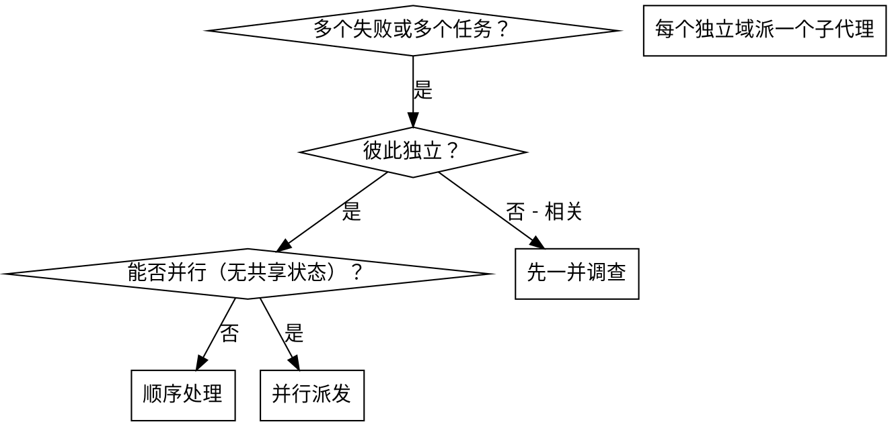

# 并行子代理（Parallel Agents）

同一个机制覆盖两类需求，先判断属于哪一种：

| 场景 | 判断依据 | 派发方式 |
|---|---|---|
| A. 多个独立任务 | 任务之间没有共享状态，处理一个不影响另一个 | 每个任务一个 `generalPurpose` 子代理 |
| B. 同一问题的多方案 | 一个问题存在 2~3 种合理做法，不确定哪种可行或最优 | 每个方案一个 `best-of-n-runner` |

**共同要点：所有派发必须写在同一条消息里才是并发；拆成多条消息就是串行。**

---

## 场景 A：并行处理多个独立任务

### 判定



适合：

- 3 个以上测试文件失败，且根因各不相同（工具审批、批量完成、中断各一处）
- 多个子系统独立损坏，理解各自问题不需要其他部分的上下文
- 各调查之间没有共享状态

不适合：

- 失败之间彼此相关（修一个可能顺带修好另一个）
- 需要先掌握整体系统状态才能定位
- 子代理会互相干扰（改同一批文件、抢同一资源）
- 还在探索性调试，连问题在哪都还不知道

### 派发格式

同一响应内发出全部派发：

```text
Task(generalPurpose): "修复 agent-tool-abort.test.ts 的失败"
Task(generalPurpose): "修复 batch-completion-behavior.test.ts 的失败"
Task(generalPurpose): "修复 tool-approval-race-conditions.test.ts 的失败"
```

### 子代理 prompt 的三要素

1. **聚焦**：一个明确的问题域（单个测试文件、单个子系统）
2. **自包含**：把错误信息、用例名、相关文件路径直接写进 prompt —— 子代理看不到你的会话历史
3. **约束与产出明确**：例如「不要改生产代码，只修测试」；要求返回「根因 + 改动摘要」

```markdown
修复 src/agents/agent-tool-abort.test.ts 中 3 个失败用例：
1. "should abort tool with partial output capture" —— 期望消息包含 'interrupted at'
2. "should handle mixed completed and aborted tools" —— 快工具被中断而非完成
3. "should properly track pendingToolCount" —— 期望 3 个结果却得到 0

这些是时序/竞态问题。你的任务：
1. 读测试文件，弄清每个用例在验证什么
2. 判断根因是时序问题还是实现缺陷
3. 修复：用基于事件的等待替换任意超时；发现实现缺陷就修实现
   不要只是把超时时间调大。

返回：根因摘要 + 具体改动。
```

### 常见错误

- 范围过宽：「把测试都修好」→ 子代理会迷路
- 缺上下文：「修一下那个竞态」→ 子代理不知道在哪
- 没约束：子代理可能顺手重构整个项目
- 产出含糊：「修好了」→ 你不知道改了什么

### 收尾

1. 逐个读返回摘要，确认实际改了什么
2. 检查冲突：多个子代理是否改了同一文件
3. 跑完整测试套件，验证合并结果
4. 抽查关键改动（子代理可能犯系统性错误）

---

## 场景 B：同一问题的多方案并行探索（Best-of-N）

适用于：一个 bug 可能对应多种根因、重构要在几种模式间取舍、性能优化有多条路线、同一功能想试不同库 —— 也就是「直接试」比「反复分析」更快的场合。

### 步骤

1. **定义 2~3 个候选方案**，写清思路与成功判据。例如优化一条慢查询：
   - 方案 A：加复合索引并重写查询
   - 方案 B：用物化视图做反范式
   - 方案 C：应用层加 Redis 缓存

2. **同一响应内并行派发** `best-of-n-runner`，一个方案一个：

   ```text
   Task(best-of-n-runner): "方案 A：..."
   Task(best-of-n-runner): "方案 B：..."
   Task(best-of-n-runner): "方案 C：..."
   ```

   每个 runner 会拿到独立 worktree 与分支；prompt 里写清成功判据（如「跑测试并报告是否通过」「给出查询耗时」）。

3. **对比结果**：测试是否全绿、实现是否干净、性能指标、长期可维护性

4. **合并胜者**：切到胜出分支合并（或挑拣具体 commit），清理其余 worktree 分支

### 注意

- 各 runner 完全隔离，互相看不到对方的改动
- prompt 要具体：文件路径、问题陈述、成功判据
- 问题简单时属于过度设计，直接用单个子代理
- 分支是真实 git 分支，可事后人工检查

---

## 与 subagent-driven-development 的分工

- 本技能解决「怎么把并行工作切开并派出去」
- `subagent-driven-development` 解决「按计划逐任务实现 + 每任务审查」的流程
- 需要真并发的独立任务用本技能；需要逐任务把关的实现流程用后者
